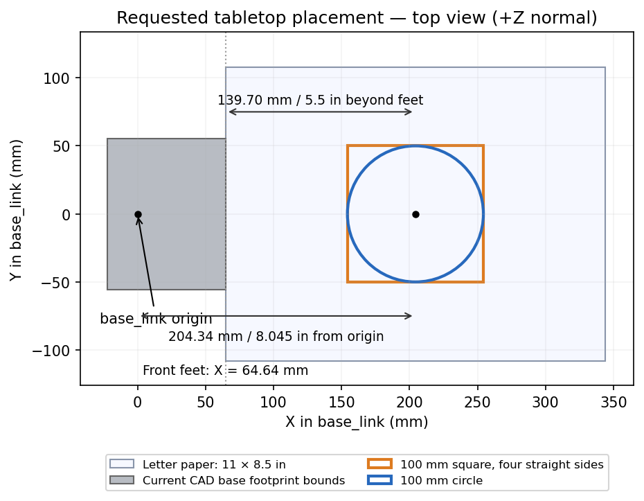

# Horizontal paper: 100 mm circle and square

November 24, 2026. Owner-selected placement and speed band. These files preserve
the exact requested geometry; **current saved wrist limits have not produced
passing tabletop trajectories**. The owner chose to retain this placement and
review wrist travel later, rather than move the paper or raise the robot.
Loading files never moves the arm. No limits were widened or physical motors moved.

## Placement

Paper is US letter, with its **11-inch length along +X**, 8.5-inch width along Y,
and its near edge against the current CAD front feet. The shapes share the paper
center at Y=0. Distances below are in `base_link`:

| Datum | Distance |
| --- | --- |
| Front of current CAD feet from origin | **64.635 mm / 2.545 inches** along +X |
| Shape center beyond front feet | **139.700 mm / 5.500 inches** |
| Shape center from origin | **204.335 mm / 8.045 inches** along +X |
| Shape X bounds | 154.335–254.335 mm |
| Shape Y bounds | −50 to +50 mm |
| Assumed paper/table height | Z = −2.400 mm |
| Air-trace pen-tip height | Z = +2.600 mm (5 mm above paper) |
| Square lift endpoint | Z = +12.600 mm (10 mm above the air trace) |

The horizontal surface's outward normal is **+Z**; the pen axis is **−Z**,
pointing down into it. In the current tool convention this is RPY [180°, 0°, 0°]
with free twist. Circle diameter and square side length are each **100 mm**.

The feet and height come from transformed vertices of the existing shared
`base_so101_v2.stl` collision mesh, including its URDF origin/rotation. They are
CAD-derived assumptions, not measurements of the ongoing base redesign. The
front is the furthest +X extent of all currently modeled base components.
New wings or other protrusions require a fresh datum check before use. The real
paper plane and physical TCP are still unmeasured; these are air traces, not
contact drawing or an instruction to lower the pen onto paper.



Reproduce the datum check without ROS or motor I/O:

```bash
python3 tools/inspect_paper_placement.py
```

## Panel examples and square sequence

Reopen the updated panel and use **Example point sets → Load example**.
The new files are installed with the other point sets:

- **09 — Tabletop: 100 mm circle:** one continuous curve with a 4–18 mm/s
  interior speed range, 80 mm/s² TCP acceleration and selected joint caps 30/180.
- **10 — Tabletop square:** four exact straight 100 mm sides, each with the same
  4–18 mm/s range. As requested, there is no corner rounding. Each matching
  lift is a separate 10 mm upward retract at fixed 18 mm/s maximum with endpoint
  ramps. The drawing-speed band applies to the sides, not stationary lift ends.

The square files alternate in this order:

| Order | Filename suffix | Operation |
| --- | --- | --- |
| 1 | `10_tabletop_square_1a_side.json` | First side |
| 2 | `10_tabletop_square_1b_lift.json` | Lift at first corner |
| 3 | `10_tabletop_square_2a_side.json` | Second side |
| 4 | `10_tabletop_square_2b_lift.json` | Lift at second corner |
| 5 | `10_tabletop_square_3a_side.json` | Third side |
| 6 | `10_tabletop_square_3b_lift.json` | Lift at third corner |
| 7 | `10_tabletop_square_4a_side.json` | Fourth side, closes square |
| 8 | `10_tabletop_square_4b_lift.json` | Final lift |

Each side uses whole-stroke start selection and a checked pen-up approach from
the preceding lift back to its start. A lift has no independent approach: it
starts at the preceding side's exact endpoint. All points remain marked pen-up.
This is the existing manual load/plan/preview/execute workflow, not a new
automatic multi-stroke job executor. Do not concatenate sides into a single
positive-speed polyline: an exact 90° corner needs zero speed at finite acceleration.

The opt-in scene `tabletop_paper_dry_run.yaml` adds a finite thin collision patch
for the assumed paper plane and retains the original example floor. It does not
change the live scene automatically or claim to model the full table/edges.
For a separate mock session:

```bash
ros2 launch pinchy_moveit_config mock_motion.launch.py \
  calibration:="$PWD/calibration/arm.json" \
  scene:="$PWD/src/pinchy_moveit_config/config/tabletop_paper_dry_run.yaml"
```

## Feasibility status

These are intentionally retained requested targets, **not executable qualified
examples under the current saved limits**. The full saved-limit mock previews
are recorded in the [validation bundle](validation/feasibility/tabletop_paper_2026_11_24/validation.md).
A separate CAD-limit center IK witness uses roughly 87° wrist flex; the saved
upper bound is approximately 63.90°. That witness also uses −2.76° pen pitch,
below the saved −0.703° minimum. A center witness is not proof that the full
circle/square will work after a range review. No new bound is inferred or applied.
Finite failed searches also do not prove global impossibility.

Review the actual wrist travel and tool/base geometry with the operator, then
repeat complete path, collision and speed checks at this placement. Physical
contact, tracking and full paper coverage remain verification work.
