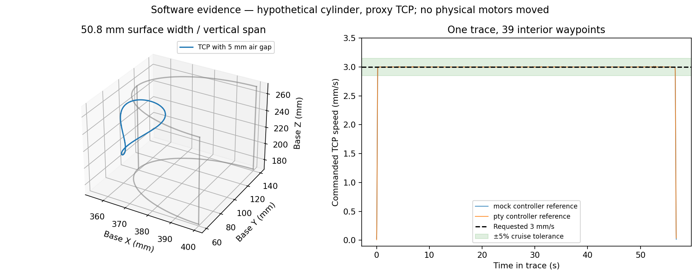
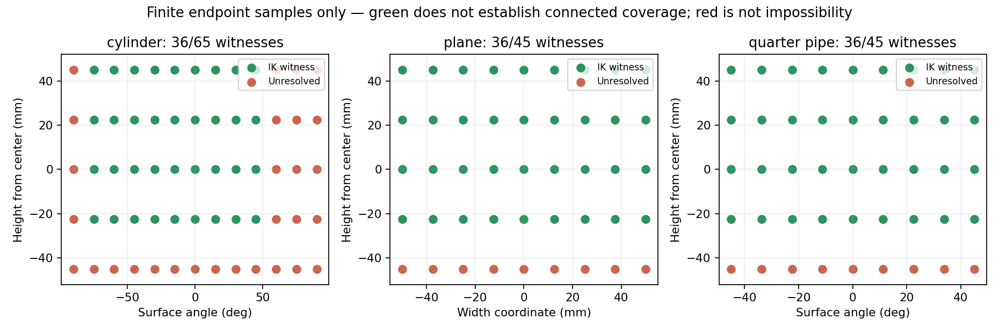

# Nominal-surface and continuous execution validation

November 15, 2026. **Software dry-run evidence only. No physical motors moved,
no live hardware was restarted, and no saved position limits were expanded.**
The shared proxy TCP, model, calibration-derived limits, controller and existing
powered safety stack were retained. See [source hashes](source_hashes.json).

## Continuous cylinder: executed on both software backends

The final assays load the packaged JSON file itself. The 41-point example spans 50.8 mm horizontally in cylinder surface coordinates
and 50.8 mm vertically. It keeps a 5 mm air gap from the nominal Ø80 × 100 mm
cylinder and points the pen +Z into the surface with axial twist free. It uses a
single continuous spline, an explicitly requested collision-planned pen-up
approach, 3 mm/s cruise, 20 mm/s² endpoint ramps and 30 deg/s / 180 deg/s² joint
caps. See [operator instructions](../../../continuous_cylinder_test.md).

| Execution backend | Live controller-reference cruise | Interior points checked | Maximum modeled normal error | Result |
| --- | --- | --- | --- | --- |
| Mock | 2.986362–3.012296 mm/s | 39/39 | 0.118734° | Completed; replay rejected. |
| Real C++ driver on PTY servo emulator | 2.986068–3.011855 mm/s | 39/39 | 0.118731° | Completed; replay rejected. |

Mock/PTY recorded 2,806/2,807 live cruise samples and checked actual reference
positions/velocities with `J_position(q) × qdot`, not just preview point spacing.
There were no intermediate waypoint stops. Both preserved the 5 mm modeled gap
within about 0.0004 mm in the command reference. This tight modeled figure is
not a real robot accuracy claim. The commanded trace lasts 56.805 s; approach
plus trace took approximately 60.75/60.94 s. Planning/validation took about 142 s on
mock and 149 s on PTY in these runs; expect minutes on this Jetson.

The mock encoder/model path spanned about 53.36 mm in Y and 50.80 mm in Z; the
PTY encoder/model path spanned about 53.57 mm and 51.65 mm. The latter completed
with a reported 0.39 mm / 0.06° encoder/model endpoint residual. These are
software/emulator observations, not independent physical measurements. The
requested 50.8 mm horizontal span is measured on the cylinder's **surface**;
the outer TCP arc is longer because of its positive stand-off.

Earlier generator-based executions also passed on both backends; their
[initial mock](generator_mock_execution.json) and [initial PTY](generator_pty_execution.json)
summaries are retained.

Data: [mock result](mock_execution.json), [PTY result](pty_execution.json), full
compressed [mock controller trace](mock_controller_trace.jsonl.gz) and
[PTY controller trace](pty_controller_trace.jsonl.gz).

## Three collision scenes and complete-path witnesses

Each opt-in scene includes the unchanged example floor, its nominal object and
an assumed fixture. These are hypothetical placements, not owner measurements.
The panel is upright; the cylinder's axis is vertical; the quarter pipe is a
closed annular-sector mesh with its concavity facing the robot. Mesh faceting
conservatively reduces the cavity and encloses the outer wall.

| Surface | Complete loop cruise, independently sampled | Central endpoint witnesses | Separately checked retract |
| --- | --- | --- | --- |
| Cylinder | 2.986123–3.012208 mm/s | 35/35 | 10 mm, passed. |
| Plane | 2.998090–3.002031 mm/s | 35/35 | 10 mm, passed. |
| Concave quarter pipe | 2.997962–3.002147 mm/s | 35/35 | 10 mm, passed. |

All three zero states were collision-valid. Every accepted complete trajectory
passed the real service's controller-polynomial bounds/rates, task geometry,
normal and sampled collision checks. Independent MoveIt FK agreed with the
shared model along each combined trajectory. Each retract starts from the
**exact accepted end configuration**, follows −tool-Z for 10 mm and separately
passes continuous IK, timing and collisions. Retracts were not executed or
silently appended to the saved loop files.

Data: [surface/path report](surface_paths.json), [planning events](planning_events.jsonl)
and compressed sampled traces for the [cylinder](cylinder_trace_samples.csv.gz),
[plane](plane_trace_samples.csv.gz) and [quarter pipe](quarter_pipe_trace_samples.csv.gz).
The equivalent packaged poses/settings are checked against the qualified
generator, including strict speed, normal mode, contact labels and dimensions.

## Wider endpoints: feasibility gate stays open

| Nominal region sampled | Collision-valid endpoint IK | Unresolved samples |
| --- | --- | --- |
| Cylinder front −90°…+90°, five heights | 36/65 | 29 |
| Plane full 100 mm width, five heights | 36/45 | 9 |
| Quarter pipe −45°…+45°, five heights | 36/45 | 9 |

Heights range ±45 mm from the object center, 5 mm inside its top/bottom rims.
Both 0.8-second and 3-second independent endpoint searches produced these
counts. The longer report records exact configurations, unsuccessful-search
residuals and observed collision pairs. Finite unresolved searches do not prove
impossibility; endpoint IK success does not establish connected-path coverage.

Nine lowest-row samples on **each** object found geometric solutions rejected
for `nominal_fixture/pen_holder_link` collision. This is a real conflict in the
assumed scene, not an absent-IK diagnosis. The cylinder's other 20 unresolved
samples are the −90°, +60°, +75° and +90° side normals; bounded searches retained task residuals
and frequently reached `pen_pitch` limits. No physical limit was changed to
manufacture a solution. Fixture design/placement, tool geometry and those side
orientations require further work before claiming full nominal coverage.
The passing central 50.8 mm loops do not qualify the remaining area.

Data: [longer endpoint study](endpoint_grid.json) and
[original quick study](endpoint_grid_quick.json).

## Regressions and reproducibility

- Three changed packages built successfully.
- All **64 focused unit tests** passed; [test output](unit_tests.txt) records the count.
  It covers IK/Jacobians, broad-arc regressions, whole-stroke selection,
  speed/contact policy, point files, panel behavior, scene mesh geometry and
  fail-closed batched collision validation.
- Eight mock integration regressions passed: contact timing, queued GUI/CLI,
  whole-stroke setup, unreachable/invalid and colliding goals, scene
  invalidation, Stop with subsequent planning, and cancellation.
- Two additional mock checks passed after applying the same collision batching
  to fixed-start traces: contact timing and spline/visit previews.
- Four real-driver/PTY regressions passed: scene invalidation, powered Stop and
  new planning, action cancellation, and temperature hold/recovery.
- Both complete cylinder execution assays above passed, including consumed-plan
  replay rejection. Existing stopped visits and fixed-pose behavior were kept.

[Integration record](integration_results.json) identifies cases and original
artifact directories. Repeat the commands in the
[continuous-test guide](../../../continuous_cylinder_test.md). For the longer
endpoint study add `--endpoint-budget 3`. The tools start their own isolated
mock or fake-bus stack, accept no physical serial port and do not use domain 42.

The original cylinder continuation stopped at 34.1%. The new search connected
backward and forward from an interior IK witness and optimized a complete
history before selecting a collision-checked approach. Neither an independent
endpoint nor optimizer success is sufficient for acceptance. All final checks
remain mandatory. Collision validation retains every original 20 ms / 0.008 rad
sample; four in-flight service requests reduce transport overhead without
thinning checks. An experimental 32-request batch caused service timeouts and
was replaced before the passing runs. The previous 90-second setup budget also
expired on the full loop; the bounded setup budget is now 360 seconds, with
480-second planning-client waits.

Step 11 is complete at this **continuous software dry-run** level. Step 12
remains partial: confirm measured placements, fixtures/table/base wings and TCP,
then establish supported complete drawing/lift regions. Physical contact is
still disabled. Actual speed, tracking, accuracy, load, thermal duty and real
Stop/recovery qualification remain in steps 13 and 23–24.

The [expanded support/coverage follow-up](../surface_gate/validation.md) retains
this baseline, clears the support collisions in proposed scenes, and adds
complete boundary paths, executions and a current-placement reach exclusion.
