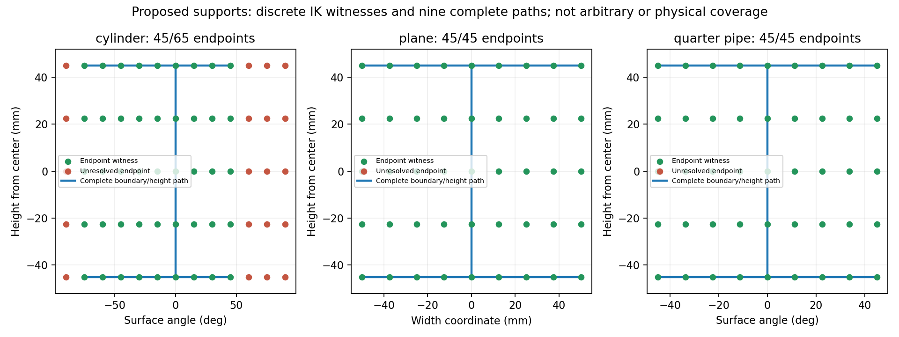
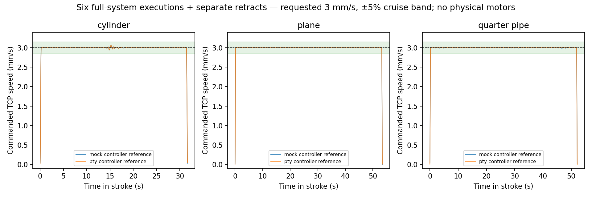

# Expanded surface feasibility gate

Software study, November 15, 2026. No physical motor moved. The active TCP,
measured zeros/directions, saved joint ranges, default joint caps and shared
controller/driver/safety stack remain unchanged. Earlier uncommitted work and
[original scene evidence](../nominal_surfaces/validation.md) are retained.

## Fixture conflicts resolved in proposed scenes

The old generic blocks overlapped the pen holder near the object's lower edge.
Three new **opt-in proposed support scenes** retain each original object and the
unchanged floor, and replace only that assumed support:

| Object | Proposed support at the existing placement |
| --- | --- |
| Ø80 × 100 mm cylinder | Ø40 × 20 mm pedestal, center `[0.40, 0.10, 0.16]` m. Its top meets the object's bottom at Z=0.17 m; no front overhang. |
| Upright 100 × 100 mm panel | 20 × 50 × 20 mm support centered `[0.37, 0.10, 0.16]` m; its front edge stays at/behind the X=0.36 m drawing face. The panel remains 3 mm thick in this simulation. |
| Concave R100 × H100 mm quarter pipe | Annular-sector pedestal: inner R99, outer R105, height 20 mm, 90°; center `[0.25, 0.10, 0.16]` m. It supports the wall rather than filling the cavity. Object wall remains 4 mm. |

These are reviewable fixture concepts, **not measured hardware, installed
fixtures, mounting/stability qualification or a measured tabletop**. All support
solids remain in collision checks; no allowed-collision exemption was added.
Original `nominal_*_dry_run.yaml` files remain available. The new files are
`nominal_*_pedestal_dry_run.yaml` in `pinchy_moveit_config/config`.

Full-width/angle endpoint witnesses improve as follows:

| Object | Original support | Proposed support |
| --- | --- | --- |
| Cylinder, −90°…+90°, five heights | 36/65 | 45/65 |
| Plane, full 100 mm width, five heights | 36/45 | 45/45 |
| Quarter pipe, full 90°, five heights | 36/45 | 45/45 |

Each study uses a 5 mm air gap and five heights spanning Z=0.175…0.265 m,
5 mm inside the nominal object's top/bottom rims. The new support clears all
nine previously obstructed lowest-row samples on each object. Data:
[pedestal endpoint study](pedestal_endpoints.json).

## Nine complete paths and retracts

Successful endpoints alone do not establish continuous drawing. Each surface
also passes **three complete 31-point paths**: lower horizontal, full-height
vertical and upper horizontal in reverse. Every one includes a whole-stroke
configuration selection, collision-planned pen-up approach, strict 3 mm/s
interior speed, preserved surface normal, full controller-polynomial and
sampled collision checks, independent MoveIt FK, and a separately checked
10 mm normal retract from its exact accepted end configuration.

| Surface coordinates tested | Height range | Complete paths |
| --- | --- | --- |
| Cylinder −75°…+45°: 120° / 83.78 mm surface arc | 90 mm | 3/3 pass. |
| Plane −50…+50 mm width | 90 mm | 3/3 pass. |
| Quarter pipe −45°…+45°: 90° / 157.08 mm inner-surface arc | 90 mm | 3/3 pass. |

The requested speed passes the existing ±5% planning tolerance on all nine
paths. The wider cylinder lower arc is the least uniform accepted case:
2.9428–3.0627 mm/s; normal error is below 0.018°. Other boundary paths are
closer to 3 mm/s. This is modeled/controller speed, not measured physical nib
speed. The 5 mm normal gap is air motion; physical contact remains disabled.



The cylinder interval is **asymmetric in base-frame surface angle** because its
center is offset in Y. The earlier summary incorrectly described the failed
samples symmetrically as ±75°/±90°. The retained raw endpoint data instead show
failures at −90°, +60°, +75° and +90°, and witnesses at −75°…+45°.
An initial wider-path test using −60°…+60° was correctly rejected; +60° was
outside that witnessed band. Its [rejected cases](rejected_initial_cylinder.json)
are retained. The corrected 120° interval retains the same arc width and passes
complete planning. This does **not** redefine the front-180° requirement or
assert that every arbitrary path inside the sampled band will pass.

[Complete-path evidence](boundary_routes.json) includes every requested pose,
setting, scene/model/profile identity, checked speed/normal/gap extrema,
independent FK result and retract. The nine reusable JSON sets are installed
under `share/pinchy_motion/examples/surface_feasibility/{surface}/` and available
in source under `src/pinchy_motion/examples/surface_feasibility/`. Load them with
**Load points…** or `pose path`; they are not silently added to the live scene.

## Six complete system executions, including actual retract execution

These tests run the actual ROS stack from saved points through IK, MoveIt
collision/approach planning, timed preview, ExecutePlan, the joint trajectory
controller and mock control or the real C++ driver connected to a PTY servo
emulator. They are **integration executions, not unit tests or previews**.

| Point set | Mock live cruise | Driver/PTY live cruise | Interior points | Retract |
| --- | --- | --- | --- | --- |
| Wider cylinder lower arc | 2.9429–3.0625 mm/s | 2.9429–3.0625 mm/s | 29/29 on each backend | Executed, both pass. |
| Saved plane two-inch loop | 2.9988–3.0020 mm/s | 2.9988–3.0020 mm/s | 39/39 on each backend | Executed, both pass. |
| Saved quarter-pipe two-inch loop | 2.9864–3.0131 mm/s | 2.9979–3.0022 mm/s | 39/39 on each backend | Executed, both pass. |

Every cruise sample passed the ±5% contract. Live reference normal/gap checks,
encoder/model path extent, controller completion, powered Stop after completion
and consumed-plan replay rejection also passed. Each separately planned retract
was **executed through the same controller and backend**, rather than left as a
preview. Existing Stop/cancel/fault tests are recorded in the
[earlier integration evidence](../nominal_surfaces/integration_results.json).
The current work does not change that safety implementation.



[Execution summary](execution_summary.json) and individual
[cylinder mock](cylinder_mock.json), [cylinder PTY](cylinder_pty.json),
[plane mock](plane_mock.json), [plane PTY](plane_pty.json),
[pipe mock](quarter_pipe_mock.json), [pipe PTY](quarter_pipe_pty.json) reports
record outcomes. Corresponding `*_controller.jsonl.gz` files preserve every
recorded controller sample. The original two-inch cylinder file already passed
both complete backends in the [step-11 evidence](../nominal_surfaces/validation.md).
These results do not measure physical tracking, contact, load or accuracy.

## Full front 180°: concrete model obstruction remains

A new necessary geometry check computes the closest possible sixth-axis origin
for a requested TCP position/normal while allowing **unrestricted axial twist**.
The modeled attachment has 149 mm axial and 18.8 mm perpendicular offsets.
That wrist-origin circle must fit within the sum of all upstream link offsets
from the shoulder-pan anchor: **415.68 mm**. Joint limits and collisions can
only reduce this upper bound.

At the current cylinder center `[0.40, 0.10, 0.22]` m, mid-height:

| Surface angle | Minimum required wrist distance | Unrestricted upstream maximum | Geometric exclusion |
| --- | --- | --- | --- |
| +75° | 434.96 mm | 415.68 mm | Exceeds by 19.28 mm. |
| +90° | 476.71 mm | 415.68 mm | Exceeds by 61.03 mm. |

These two targets are outside this model's reach at that placement, independently
of IK seeds, starting posture or wrist-range expansion. This is a necessary
reach exclusion, **not** a claim that every other unresolved point is impossible.
Passing the bound proves neither IK nor collision-free continuity. Tests verify
that it never rejects 100 independently sampled FK-generated reachable poses.
Data: [reach bounds](wrist_reach_bounds.json); implementation:
`pinchy_motion.feasibility.wrist_reach_bound`.

A separate [58-placement study](placement_study.json) checked −90°, 0° and +90°
endpoints over alternative X/Y/height placements without changing the TCP or
saved bounds. No placement returned witnesses for all three. Those finite
searches are **not a global proof** that another placement cannot work. An
additional 48-start coupled least-squares study optimized a shared center XYZ
and all three endpoint configurations together, retaining saved joint bounds.
It also found no exact three-endpoint witness. Those local optimizations are
likewise finite and are not a global infeasibility proof. No
collision/connected-path claim is made for that numerical placement sweep.

The current model therefore does **not** support a full-front-180° claim at the
proposed placement. Closing that product requirement needs a reviewed placement
or tool/mechanical change and new tests, or the owner's explicit acceptance of
a smaller drawing region. This work does not make that scope decision for the
owner. Measure the actual tool transform before redesigning around an
unmeasured proxy. Physical fixture/table/base-wing geometry also remains an
owner measurement; software cannot certify unseen hardware.

## Reproduce

From `robot_software/`, source ROS and the built workspace:

```bash
OPENBLAS_NUM_THREADS=1 python3 tools/qualify_nominal_paths.py \
  --grid-only --full-grid --support pedestal --endpoint-budget 1.5 \
  --output-dir /tmp/pedestal-endpoints
OPENBLAS_NUM_THREADS=1 python3 tools/qualify_surface_routes.py \
  --output-dir /tmp/surface-boundaries
OPENBLAS_NUM_THREADS=1 python3 tools/qualify_continuous_execution.py \
  --surfaces plane quarter_pipe --support pedestal --retract
OPENBLAS_NUM_THREADS=1 python3 tools/qualify_continuous_execution.py \
  --emulated --surfaces plane quarter_pipe --support pedestal --retract
OPENBLAS_NUM_THREADS=1 python3 tools/qualify_continuous_execution.py \
  --emulated --surfaces cylinder --support pedestal --retract \
  --points src/pinchy_motion/examples/surface_feasibility/cylinder/lower_horizontal.json
OPENBLAS_NUM_THREADS=1 python3 tools/check_surface_placement.py \
  --joint-search 48 --output /tmp/cylinder-placements.json
```

The same cylinder command without `--emulated` repeats its mock execution.
These harnesses launch only isolated mocks or fake-bus stacks; they accept no
physical serial port. Planning several complete paths takes minutes per case
on this Jetson. Every file still requires a new start/model/scene-checked preview
and explicit execution. `--support pedestal` chooses a hypothetical scene only
inside these isolated test processes; it does not alter the running real robot.

All three changed packages built successfully. The expanded **69-test** focused
suite passed; [unit output](unit_tests.txt) and [source hashes](source_hashes.json)
record the implementation. Run `plot_results.py` here to regenerate the plots.
Step 12 now has the fixture proposals, broader complete-path witnesses,
full-system execution evidence and a definite current-placement reach exclusion.
The physical setup and full-180° decision remain open; step 13 and verification
steps 23–24 still own pen/contact and measured physical performance.
